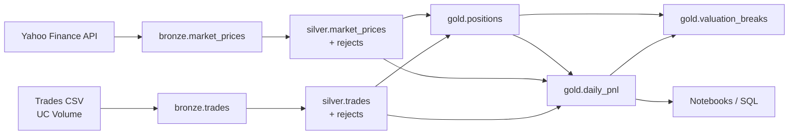

# Trading ETL & Daily P&L on Databricks

## Overview

A proof of concept that turns a dirty trades CSV and daily equity closing prices into validated trades, daily positions, daily mark-to-market P&L and valuation exceptions. It runs as a six-task Databricks Job over a Bronze → Silver → Gold Delta Lake architecture in the Unity Catalog catalog `cibc`, deployed with a Databricks Asset Bundle. Every task writes an audit row, and two notebooks let users run the Job and review the results.

Detailed architecture and design: [`docs/trading_pipeline_description.html`](docs/trading_pipeline_description.html). Table contracts: [`docs/data_contracts.md`](docs/data_contracts.md). Demo queries: [`docs/demo_queries.sql`](docs/demo_queries.sql).

This is a proof of concept, not a production system.

## Architecture



| Layer | Tables | Responsibility |
|---|---|---|
| **Bronze** | `cibc.bronze.market_prices`, `cibc.bronze.trades` | Raw data as strings plus `source_file`/`source_api`, `ingestion_timestamp`, `run_id`. Prices are MERGEd on (`symbol`, `price_date`). Trades: the CSV is a complete snapshot, so identical rows are dropped and the table is replaced with `INSERT OVERWRITE`. Header, empty-file and malformed-row checks run before anything is written. |
| **Silver** | `cibc.silver.market_prices`, `cibc.silver.trades`, `*_rejects` | Type casting, business validation, deduplication and version selection. Invalid records go to reject tables with pipe-separated reasons. Conditional MERGE on business keys. |
| **Gold** | `cibc.gold.positions`, `cibc.gold.daily_pnl`, `cibc.gold.valuation_breaks`, `cibc.gold.pipeline_run_log` | Positions per date, book, counterparty and instrument; daily P&L per date, book and symbol; valuation breaks per run; task audit log. |

**Daily P&L** = opening quantity × (current close − previous close) + Σ signed trade quantity × (current close − trade price). Positions and P&L use the exact-date close. If a price is missing, the value stays NULL (never 0) and a valuation break is recorded.

## Technology Stack

- Databricks serverless Jobs (Workflows) and Databricks Asset Bundles
- PySpark and Delta Lake (MERGE, `INSERT OVERWRITE`, CHECK constraints, time travel)
- Unity Catalog (catalog `cibc`, schemas `bronze` / `silver` / `gold`, Volume `cibc.bronze.trade_files`)
- Python 3.10+ wheel `trade_pipeline` (`yfinance`, `pandas`, `numpy<2`)
- Databricks SDK in notebooks; pytest for local tests

## Pipeline Workflow

```
ingest_prices ──> process_prices ──┐
                                   ├──> build_positions ──> calculate_daily_pnl
ingest_trades ──> process_trades ──┘
```

| Task | Reads | Writes |
|---|---|---|
| `ingest_prices` | Yahoo Finance | `bronze.market_prices` |
| `process_prices` | `bronze.market_prices` | `silver.market_prices`, `market_prices_rejects` |
| `ingest_trades` | CSV in `/Volumes/cibc/bronze/trade_files/` | `bronze.trades` |
| `process_trades` | `bronze.trades` | `silver.trades`, `trades_rejects` |
| `build_positions` | Silver trades and prices | `gold.positions`, `valuation_breaks` |
| `calculate_daily_pnl` | Gold positions, Silver trades and prices | `gold.daily_pnl`, `valuation_breaks` |

Job parameters: `tickers` (blank = 10 default tickers), `start_date`, `end_date` (inclusive `YYYY-MM-DD`; blank = last 7 days up to the runtime's current date) and `trade_input_path`. The weekday 6 PM America/New_York schedule (`0 0 18 ? * MON-FRI`) is configured but **paused**; development-mode deployments keep it paused.

## Running the Pipeline

Prerequisites: a Unity Catalog workspace, Python 3.10+, bash (Git Bash on Windows) and the Databricks CLI.

1. **Authenticate** (OAuth; no secrets in the repository) and set the workspace host in `databricks.yml`:

   ```bash
   databricks auth login --host https://<your-workspace>.cloud.databricks.com --profile <profile>
   export DATABRICKS_CONFIG_PROFILE=<profile>
   ```

2. **Create Unity Catalog objects** in the SQL editor, in order: `database/catalog.sql`, `bronze.sql`, `silver.sql`, `gold.sql`, `volumes/trade_files.sql`, then `database/tables/{bronze,silver,gold}/*.sql`. Use `database/grants.sql` if the Job runs as a different principal.

3. **Upload the trade CSV** (generated deterministically by `scripts/generate_trades.py`):

   ```bash
   databricks fs cp data/dirty_trades.csv dbfs:/Volumes/cibc/bronze/trade_files/dirty_trades.csv
   ```

4. **Build, validate and deploy** (the bundle builds and uploads the wheel and syncs the notebooks):

   ```bash
   ./scripts/deploy.sh build      # optional local wheel check
   ./scripts/deploy.sh validate
   ./scripts/deploy.sh deploy
   ```

5. **Run** from the CLI, the Jobs UI or notebook `notebooks/01_run_pipeline` (requires `confirm_run = YES`):

   ```bash
   ./scripts/deploy.sh run --params start_date=2026-09-01,end_date=2026-09-30
   ```

6. **Review** with notebook `notebooks/02_pipeline_report` (run summary, rejections, positions, P&L, breaks, daily execution monitoring) or `docs/demo_queries.sql`. Task results are in `cibc.gold.pipeline_run_log`.

Local tests: `python -m pytest tests -q`. Spark-based tests are skipped when PySpark and Java are not installed; skipped tests are not passes.

## Design Decisions and Trade-offs

- **Market data provider.** The challenge requests Stooq, but its endpoint returned HTTP 404 from the test environment, so the pipeline uses Yahoo Finance (`yfinance`, unadjusted closes). This does not strictly meet the requirement. The provider is isolated in `bronze/ingest_prices.py`, so it can be replaced without changing Silver or Gold.
- **Trade versioning.** Per `trade_id`, the highest `version` wins, then the latest `modified_timestamp`. If the latest version is invalid or ambiguous, an older version is not used and the trade is removed from Silver. Superseded versions are kept in the reject table.
- **Idempotency.** Bronze trades are a full snapshot replaced with `INSERT OVERWRITE`; prices, Silver and Gold use business-key MERGEs that only rewrite changed rows; rejects are written once. Rerunning the same inputs leaves business tables unchanged, while the audit log and valuation breaks gain rows for the new run.
- **Snapshot Bronze trades.** Simple and idempotent, but only the latest file is kept (older ones only through Delta time travel), and trades missing from a later file are not removed from Silver.
- **Valuation policy.** Exact-date prices only; missing prices produce NULL values and breaks rather than stale prices.
- **Full recompute.** Silver trades and Gold are recalculated from full history each run, which keeps corrections simple but will not scale indefinitely.
- **Assumptions.** USD only; ten hard-coded instruments; no trade status or cancellations; simplified NYSE calendar (no early closes or special closures); daily mark-to-market P&L with no fees, dividends, corporate actions or FX.

**Potential production enhancements:** an approved market-data feed; reference data for instruments, counterparties and books; trade lifecycle events; an authoritative exchange calendar; incremental processing; multi-currency support; a production bundle target with a service principal; alerting and SLA monitoring; CI with Spark tests.
